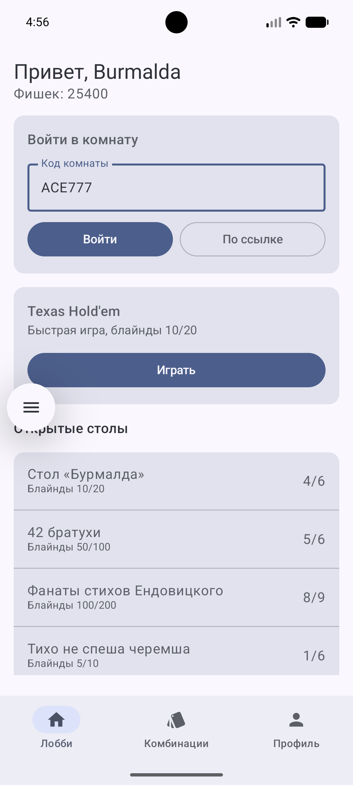
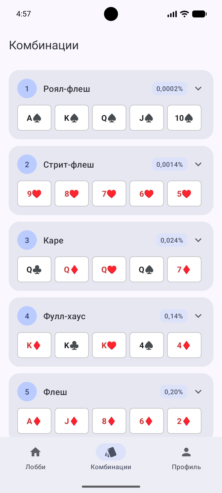
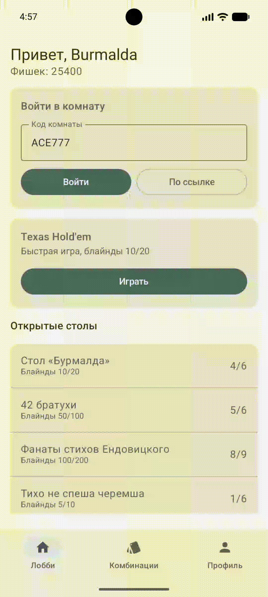

# Burmalda67

Заготовка приложения для игры в покер (Kotlin, Jetpack Compose, Material 3).

## 1. Экран на аттестацию — Лобби

Главный экран: приветствие и баланс фишек, вход в комнату по коду, быстрая игра в Техасский холдэм, список открытых столов.
Подстраивается под ширину экрана: на узких телефонах кнопки встают в столбик, в альбомной ориентации контент не растягивается.



Код: [`LobbyScreen.kt`](app/src/main/java/com/example/burmalda67/ui/lobby/LobbyScreen.kt)

## 2. RecyclerView — вкладка «Комбинации»

Список покерных комбинаций на RecyclerView: своя разметка элемента и адаптер с ViewHolder. По нажатию раскрывается описание.



Код:
- [`CombinationsAdapter.kt`](app/src/main/java/com/example/burmalda67/ui/combinations/CombinationsAdapter.kt) — адаптер
- [`item_combination.xml`](app/src/main/res/layout/item_combination.xml) — разметка элемента списка
- [`CombinationsScreen.kt`](app/src/main/java/com/example/burmalda67/ui/combinations/CombinationsScreen.kt) — экран со списком
- [`HandCombination.kt`](app/src/main/java/com/example/burmalda67/data/HandCombination.kt) — данные

## 3. Явный и неявный Intent

В Лобби есть поле «Код комнаты» и две кнопки:
- **Войти** — явный Intent: `Intent(context, RoomActivity::class.java)` + `putExtra("code", code)`;
- **По ссылке** — неявный Intent: `Intent(Intent.ACTION_VIEW, Uri.parse("burmalda://room/$code"))`, активность находит система по intent-filter в манифесте.

Открывается `RoomActivity`, на ней код комнаты и пометка `(Intent)` или `(неявный Intent)`.



Код:
- [`LobbyScreen.kt`](app/src/main/java/com/example/burmalda67/ui/lobby/LobbyScreen.kt) — функции `openRoom` и `openRoomByLink`
- [`RoomActivity.kt`](app/src/main/java/com/example/burmalda67/RoomActivity.kt) + [`activity_room.xml`](app/src/main/res/layout/activity_room.xml)
- [`AndroidManifest.xml`](app/src/main/AndroidManifest.xml) — intent-filter для ссылок `burmalda://room/...`

Ссылку можно открыть и снаружи:

```
adb shell am start -a android.intent.action.VIEW -d "burmalda://room/ACE777"
```
